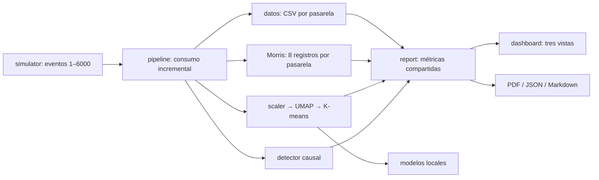

# Ciberseguridad en tiempo real — Computación Masiva para Big Data

Aplicación local en **Python 3.12, Streamlit y Plotly**, conforme a [Trabajo 5](enunciado_Trabajo_5.pdf). Emite 6.000 resúmenes de autenticación y permite observar cómo un volumen de fallos parecido puede afectar a muchas más cuentas. La ejecución usa **Morris con ocho registros por pasarela, UMAP real en dos dimensiones y K-means real con tres centroides**.

La [auditoría de la rúbrica](docs/CUMPLIMIENTO.md) relaciona los cinco criterios de dos puntos con funciones, pruebas y evidencias. Los [resultados y la validación](docs/VALIDACION.md) documentan lo ejecutado. Ningún grupo ni alerta exploratoria demuestra por sí solo un incidente real.

## Arranque en VSCode y Windows (PowerShell)

Abre **la carpeta que contiene `app.py`** en VSCode y usa `Terminal > Nuevo terminal`. Instala Python 3.12 si no está disponible. No necesitas modificar el PATH de Streamlit:

```powershell
py -3.12 -m venv .venv
.\.venv\Scripts\python.exe -m pip install --upgrade pip
.\.venv\Scripts\python.exe -m pip install -r requirements-lock.txt
.\.venv\Scripts\python.exe -m streamlit run app.py
```

En VSCode, selecciona `.venv\Scripts\python.exe` con `Python: Select Interpreter`. La instalación necesita conexión a Internet; la aplicación y los modelos funcionan localmente después.

Si quieres activar el entorno:

```powershell
.\.venv\Scripts\Activate.ps1
python -m streamlit run app.py
```

Si PowerShell bloquea `Activate.ps1`, usa directamente `.\.venv\Scripts\python.exe`: activar el entorno es opcional. `INICIAR_WINDOWS.cmd` proporciona el mismo arranque asistido. También se conserva `PREPARAR_WINDOWS.cmd` para preparar el entorno por separado. La interfaz se abre en `http://localhost:8501`.

En macOS/Linux:

```bash
python3.12 -m venv .venv
.venv/bin/python -m pip install -r requirements-lock.txt
.venv/bin/python -m streamlit run app.py
```

El comando principal, con el entorno activado, es siempre **`python -m streamlit run app.py`** desde la raíz.

## Ejecución completa, pruebas y revisión

```powershell
# Suite completa: incluye 6.000 eventos con UMAP/sklearn reales y pruebas de Streamlit.
.\.venv\Scripts\python.exe -m pytest -q

# Ejecución de referencia en datos/, resultados/ y modelos/.
.\.venv\Scripts\python.exe run_experiment.py

# Audita CSV, hashes, estadísticas y modelos locales de confianza.
.\.venv\Scripts\python.exe verificar.py --require-ml

# Abre directamente la ejecución terminada; no regenera ni entrena.
.\.venv\Scripts\python.exe -m streamlit run app.py -- --review .

# Regenera el PDF y actualiza su hash, comprobando antes la integridad.
.\.venv\Scripts\python.exe pdf_report.py --run-dir .
```

Con el entorno activado los comandos equivalentes son `python -m pytest -q`, `python run_experiment.py`, `python verificar.py --require-ml` y `python pdf_report.py`. En macOS/Linux sustituye el intérprete de Windows por `.venv/bin/python`.

Para conservar otra ejecución: `python run_experiment.py --output-dir ejecuciones/defensa`. **`--output-dir` designa la raíz de una ejecución**, dentro de la cual se crean `datos/`, `resultados/` y `modelos/`. La nueva organización sustituye a la antigua salida mezclada en `datos/`.

Cada inicio de CLI archiva los productos anteriores de esa raíz en `historial/<fecha-id>/`. En Streamlit cada inicio crea una carpeta nueva en `ejecuciones/`. Abrir la aplicación no trunca archivos. Un bloqueo impide dos escritores en la misma raíz. No compartas una misma ejecución activa entre procesos.

`--sin-ml` conserva el diagnóstico de CSV y Morris, pero **no cumple el enunciado completo y no habilita el modo revisión**. Sus informes identifican expresamente que ML no se ha ejecutado. Los dobles de prueba tampoco se presentan como ejecución real.

## Inicio y simulación

La aplicación abre en **Inicio**, una presentación del experimento, sus técnicas y lo que puedes descubrir. **Explorar la simulación** abre el espacio de trabajo sin generar eventos hasta que pulses Iniciar. Las pestañas superiores **Inicio / Simulación** permiten volver al inicio: la reproducción se pausa y conserva el progreso de la sesión. El acceso directo `-- --review .` sigue abriendo los resultados guardados.

## Las tres vistas

El resumen superior destaca las cuentas y los fallos de Cobalto, su cambio respecto a Ámbar y el número de eventos. Las cifras usan formato español: `97.440` son noventa y siete mil cuatrocientos cuarenta intentos; `18,10` son cuentas por minuto. Los iconos de ayuda explican las unidades y el periodo de cada KPI. La conclusión final aparece solo al completar los cuatro periodos de 1.500 resúmenes.

1. **Fallos y Morris.** Suma exacta del CSV, estimación de Morris, diferencia con signo, error absoluto y relativo, ocho registros y sus estimaciones, evolución de volumen y error. Las unidades son intentos fallidos; una fila representa un minuto, no un solo fallo. Los registros individuales se consultan en el desplegable inferior.
2. **Mapa UMAP y grupos.** Puntos con ID, instante, pasarela, fallos, cuentas, IP y perfil de auditoría. Filtros de pasarela, periodo y grupos; centroides fijos; medias por grupo y matriz de correspondencia con los perfiles. Las etiquetas 0, 1 y 2 no tienen un significado prefijado. La comparación global de frecuencias se etiqueta aparte de la selección del mapa.
3. **Antes y después.** Se habilita la comparación final cuando hay **1.500 resúmenes por pasarela y periodo**. Muestra cuentas, fallos e IP por minuto, cambios absolutos y porcentuales, frecuencias de grupos y perfiles, y diferencia en diferencias. Las cuentas distintas de cada minuto no son cuentas únicas de todo el periodo.

Ámbar y Cobalto conservan sus colores ocre y azul en todas las comparativas. Los grupos 0, 1 y 2 usan una paleta diferente, conservan sus ID y se describen con estadísticas observadas. El mapa mantiene sus límites al filtrar, incluye los centroides C0–C2 y dispone de **Restablecer**. La distribución global está identificada aparte de los datos filtrados.

Para una defensa breve: muestra el resumen, contrasta CSV y Morris, explica los 300 puntos de ajuste y los 5.700 transformados en el mapa, y termina comparando las barras de cuentas y fallos. El desplegable **Guía de defensa** relaciona las cinco evidencias con la rúbrica. Las tablas detalladas, el detector y las descargas siguen disponibles. [Revisión visual y pruebas del rediseño](docs/REDISENO_UI.md).

Los controles permiten iniciar, pausar, reanudar, avanzar un lote, cambiar la espera y reiniciar con confirmación. La primera proyección aparece en **300** y las siguientes en **400, 500, …, 6000**. La velocidad solo modifica la espera real; el motor nunca altera esos lotes ni las semillas. Una operación UMAP ya iniciada termina antes de atender la pausa.

La interfaz serializa el procesamiento y la lectura de cada lote, incluso entre sesiones del mismo servidor, para evitar invocaciones concurrentes de Numba y resultados parciales durante un rerun. `runner.fastReruns=false` permite terminar la operación en curso. Los filtros reutilizan una copia de los datos del último lote completo; al avanzar o cargar otra ejecución se actualiza esa copia.

El modo **Revisión** carga una raíz terminada, valida su manifiesto y recalcula estadísticas desde los archivos observados. Reproduce Morris y el detector para comprobarlos; no llama al simulador ni ajusta UMAP/K-means. Los filtros usan las mismas funciones que el modo simulación y el informe.

## Experimento y algoritmos

- Inicio fijo: **10/11/2026 a las 08:00**, tiempo simulado sin zona horaria. 3.000 minutos, dos eventos por minuto: Ámbar ID impar primero, Cobalto ID par después, mismo instante.
- Simulador: `numpy.random.default_rng(42)`. Las cuatro medidas se sortean como enteros uniformes con extremos incluidos.

| Perfil | Correctos | Fallos | Cuentas | IP |
|---|---:|---:|---:|---:|
| Pocos fallos | 40–70 | 2–6 | 1–2 | 1–2 |
| Fallos concentrados | 40–70 | 30–50 | 1–3 | 1–3 |
| Fallos repartidos | 40–70 | 30–50 | 20–30 | 8–16 |

En ID 1–3000: probabilidades **20/70/10 %** en ambas pasarelas. Después Ámbar conserva la mezcla y Cobalto usa **20/10/70 %**. Son probabilidades generadoras, no porcentajes empíricos forzados. La esperanza de fallos permanece en `0,2×4 + 0,8×40 = 32,8/min`.

**Morris.** Semilla 420042 con dos flujos derivados mediante `SeedSequence.spawn`, independientes del simulador. Cada fallo produce ocho sorteos distintos: para cada registro `c`, si `u < 2**(-c)`, incrementa `c`. Estimación individual `2**c - 1`, y media de exactamente ocho estimaciones por pasarela. No se omiten incrementos lógicos.

**UMAP/K-means.** Un único `StandardScaler` y `UMAP(n_components=2, n_neighbors=15, min_dist=0.1, metric='euclidean', random_state=42, transform_seed=42, n_jobs=1)` se ajustan con ID 1–300. K-means usa `n_clusters=3, n_init=20, random_state=42` sobre esos 300 puntos. Las entradas son exclusivamente `accesos_correctos, fallos, cuentas, ips_origen`. Los otros 5.700 eventos usan `scaler.transform → umap.transform → kmeans.predict` en 57 lotes de 100. El motor rechaza un segundo ajuste. La prueba completa observa las llamadas reales a `fit`, `transform` y `predict` y comprueba que no cambian scaler, proyección inicial ni centroides.

## Detección complementaria de cambios

Incluida dentro de la tercera vista, sin sustituir las técnicas obligatorias:

- Media móvil causal de **100 resúmenes por pasarela**.
- Referencia fija: media de cuentas de los primeros **300 resúmenes de cada pasarela**, únicamente cuando ya se han observado.
- Primera evaluación después de disponer de una ventana completa posterior a la referencia; evaluaciones cada **20 minutos**.
- Candidato: aumento de Cobalto ≥ `max(3 cuentas/min, 50 % de su referencia)` y aumento diferencial frente a Ámbar ≥ `3 cuentas/min`.
- Alerta tras **3 ventanas evaluadas consecutivas**; registra primera detección, instante, referencia, magnitud y valores observados. Umbrales y persistencia se configuran antes de iniciar otra simulación.

El detector no consulta perfiles ni el ID 3001. Sus ventanas solapadas no son pruebas estadísticas independientes; los umbrales son exploratorios y no están calibrados para incidentes reales. En una referencia contaminada o con cambios comunes a ambas pasarelas podría no detectar el comportamiento.

## Arquitectura y archivos



```text
app.py / dashboard.py      Controles, sesión y tres vistas Plotly
bi_metrics.py              Datos de presentación y formato español; reutiliza report.py
bi_charts.py / ui_theme.py  Figuras, colores semánticos y estilos de la interfaz
ui_runtime.py              Coordinación entre reruns y sesiones; procesamiento sin solapamientos
playback.py                Reloj de reproducción, sin generación de datos
config.py / simulator.py   Contrato oficial, generador y escritor CSV
morris.py                  Ocho registros y RNG independientes
analytics.py               Ajuste inicial único, inferencia y modelos joblib
pipeline.py                Motor común de Streamlit y CLI; finalización automática
detection.py               Referencia observada, ventanas y primera detección
report.py / pdf_report.py  Estadísticas compartidas y defensa automática
storage.py                Rutas, archivado, exclusión de escritores y SHA256
validation.py / review.py  Integridad estructural y revisión sin regeneración
run_experiment.py          CLI de ejecución completa
verificar.py               Auditoría de los entregables y modelos
requirements.txt          Versiones exactas directas y de la cadena ML
requirements-lock.txt     Entorno completo de referencia, versiones exactas
requirements-browser.txt  QA visual opcional con Chrome local
tests/                    Unitarias, integración real y Streamlit AppTest
docs/                     Auditoría inicial, rúbrica, resultados y capturas
tools/verify_browser.py    Recorrido real de navegador reproducible
datos/                    ambar.csv y cobalto.csv (3.000 filas cada uno)
modelos/                  scaler.joblib, umap.joblib, kmeans.joblib, metadatos.json
resultados/               Proyección, historiales, resumen JSON, defensa MD/PDF
ejecucion.json            Estado final y hashes de los entregables
historial/                Copias de ejecuciones previas (no son la referencia actual)
ejecuciones/              Ejecuciones adicionales de la interfaz
```

El [informe PDF actual](resultados/Informe_Defensa_Tecnica.pdf) y [resumen auditable](resultados/resumen_defensa.json) son los entregables de referencia. El PDF antiguo de la raíz se conservó en `historial/documentos_originales/` para evitar confundirlo con el actual.

## Persistencia y reproducibilidad

Probado con **Python 3.12.2**, NumPy 2.5.5, pandas 2.3.3, scikit-learn 1.9.1, umap-learn 0.5.12, Streamlit 1.67.0, Plotly 6.9.0 y ReportLab 4.5.1. Las versiones de SciPy, Numba, llvmlite y pynndescent también están fijadas. `pip check` comprueba la compatibilidad instalada. `requirements-lock.txt` permite instalar el entorno exacto; `requirements.txt` fija las dependencias directas y de ML.

`modelos/metadatos.json` contiene semillas, versiones, parámetros, cuatro variables, ID 1–300, centroides, 57 lotes y recuentos 300/5700/6000. Los ajustes se guardan al entrenar y al terminar. Las semillas, versiones y tamaño/orden de los lotes forman parte del protocolo reproducible; otras versiones o plataformas pueden producir diferencias numéricas.

**Carga de confianza:** `FixedUMAPClusters.load(Path('.'), trusted_local=True)` valida hashes y versiones antes de cargar. Usa únicamente ejecuciones locales propias: joblib puede ejecutar código al deserializar y los hashes no autentican archivos de terceros. El dashboard de revisión usa CSV/JSON y no carga joblib.

El manifiesto se marca completo solo después de exportar y generar el PDF. Si el proceso termina abruptamente, la ejecución parcial se conserva pero no se puede revisar como completa. La pausa sobrevive a reruns en la misma sesión; **no se reanuda una simulación parcial tras cerrar el proceso o perder la sesión del navegador**. Una ejecución terminada sí se revisa desde disco. Si queda `.execution.lock`, verifica que el escritor haya terminado antes de retirarlo manualmente.

## Pruebas y evidencias

La suite incluye generación, probabilidades y límites inclusivos, reglas de Morris, corrupción de datos, reentrenamiento prohibido, una integración real de 6.000 eventos, reutilización de modelos, detector causal, integridad, PDF y controles/filtros de Streamlit. No se usa un doble de prueba como única evidencia de ML.

QA visual opcional (Chrome instalado):

```powershell
.\.venv\Scripts\python.exe -m pip install -r requirements-browser.txt
# Terminal 1: abrir la ejecución terminada de referencia.
.\.venv\Scripts\python.exe -m streamlit run app.py -- --review .
# Terminal 2: capturas, filtros, descargas y una nueva simulación completa.
.\.venv\Scripts\python.exe tools/verify_browser.py --simulate
```

Las capturas del rediseño se guardan en `docs/capturas_ui/`, el recorrido del navegador en `docs/navegador_ui.json` y la validación automática en `docs/pytest-ui.xml`. Los registros anteriores se conservan aparte. La validación nativa se realizó en macOS; las rutas y comandos de PowerShell están preparados, pero no se ejecutó una máquina Windows en esta sesión.

## Límites e interpretación

Morris conserva su error probabilístico; no se aumentan registros para mejorar el resultado. UMAP preserva relaciones locales con distorsión y sus ejes no tienen unidades físicas. Los centroides fijos cumplen el enunciado y no se adaptan a comportamientos nuevos. Los perfiles están muy separados por construcción; una correspondencia perfecta en estos datos no demuestra eficacia sobre tráfico real. La diferencia en diferencias es descriptiva en este experimento controlado, no una inferencia causal general sobre ciberataques.

Se conservan en Git los CSV sintéticos, modelos, informes y metadatos de referencia. Solo se excluyen cachés, entornos, secretos, bloqueos, copias históricas y ejecuciones adicionales redundantes. El repositorio de entrega es [Cuet1so/Trabajo_Ciberseguridad-BigData](https://github.com/Cuet1so/Trabajo_Ciberseguridad-BigData). La carpeta utilizada durante la auditoría era una copia sin `.git`; la sincronización conserva el historial remoto y los archivos adicionales existentes. Para disponer del historial local, clona el repositorio desde GitHub.

Referencias técnicas consultadas: [reproducibilidad UMAP](https://umap-learn.readthedocs.io/en/latest/reproducibility.html), [fragmentos Streamlit](https://docs.streamlit.io/develop/api-reference/execution-flow/st.fragment), [persistencia segura de scikit-learn](https://scikit-learn.org/stable/model_persistence.html). La autoridad de los requisitos del trabajo sigue siendo el PDF del profesor.
