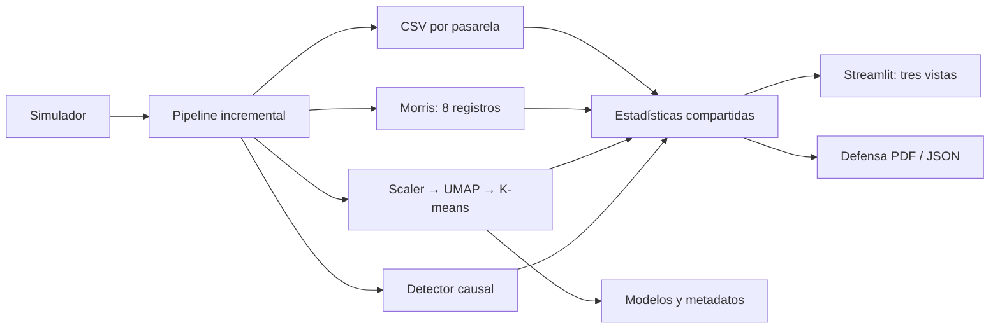

# CYBER DATA — Ciberseguridad en tiempo real

Laboratorio local de **Computación Masiva para Big Data**: 6.000 resúmenes de autenticación, dos pasarelas, Morris, UMAP y K-means reales. Permite comprobar cómo un volumen de fallos parecido puede afectar a muchas más cuentas. Requisitos: **Python 3.12**, conexión para instalar dependencias y un navegador. No requiere registro ni servicios externos durante el experimento.

## Arranque en VSCode

Abre la carpeta que contiene `app.py` y crea un terminal en VSCode.

**Windows · PowerShell**

```powershell
.\PREPARAR_WINDOWS.cmd
.\.venv\Scripts\python.exe -m streamlit run app.py
```

**macOS / Linux**

```bash
bash ./PREPARAR_ENTORNO.sh
.venv/bin/python -m streamlit run app.py
```

Abre **http://localhost:8501**. Para detener el servidor, pulsa **Ctrl+C** en el terminal. En VSCode selecciona el intérprete de `.venv` mediante `Python: Select Interpreter`. Con el entorno activado, el comando principal es `python -m streamlit run app.py`; activarlo es opcional si utilizas las rutas anteriores.

Los preparadores reutilizan `.venv` solo si utiliza Python 3.12, instalan **requirements-lock.txt**, verifican importaciones y ejecutan `pip check`. Windows ofrece instalar Python con winget **tras tu confirmación** si no está disponible. `INICIAR_WINDOWS.cmd` llama al mismo preparador y abre Streamlit. No se borra un entorno incompatible: renómbralo antes de preparar otro. Las rutas con espacios están entrecomilladas.

## Recorrido para evaluar el trabajo

1. **Inicio → Revisar resultados**: valida y abre directamente la ejecución de referencia incluida, sin generar eventos ni entrenar ML.
2. **Fallos y Morris**: compara suma CSV, ocho registros, estimación y errores. Abre el desplegable para inspeccionar cada contador.
3. **Mapa UMAP y grupos**: filtra pasarela, periodo, grupos y origen de la proyección. Muestra los 300 puntos de ajuste frente a los 5.700 transformados, centroides, medias y correspondencia con perfiles.
4. **Antes y después**: compara cuentas/minuto y fallos/minuto, frecuencias de grupos y perfiles y diferencia en diferencias con Ámbar.
5. **Guía de defensa** y **Evidencia descargable**: presenta los cinco criterios y descarga ambos CSV, PDF, resumen JSON y proyecciones.

**Nueva simulación** abre el espacio de trabajo; pulsa **Iniciar simulación** para generar desde el evento 1. Pausa, reanuda, cambia la espera, avanza un lote o reinicia con confirmación. Volver a Inicio pausa y conserva el progreso durante la sesión. Navegar y filtrar no genera eventos. Solo se construye la vista activa; sus filtros sobreviven a la navegación. La primera proyección aparece en 300 y después en 400, 500, …, 6000 (58 actualizaciones).

El modo **Revisión** permite elegir otras ejecuciones completas o indicar su carpeta. Comprueba hashes, CSV, modelos declarados, asignaciones y estadísticas; reproduce Morris y el detector para contrastarlos. No ajusta UMAP/K-means ni deserializa joblib. Las comparaciones definitivas solo aparecen al reunir 1.500 resúmenes por pasarela y mitad. Los colores ocre/azul identifican las pasarelas; los ID de grupo son arbitrarios y se interpretan mediante sus datos.

## Reproducir y verificar

Con `.venv` activado:

```bash
python -m pip check
python -m pytest -q
python run_experiment.py --output-dir ejecuciones/defensa
python verificar.py --output-dir ejecuciones/defensa --require-ml
python -m streamlit run app.py -- --review ejecuciones/defensa
```

Sin activar el entorno, antepone `.\.venv\Scripts\python.exe` en Windows o `.venv/bin/python` en macOS/Linux en lugar de `python`. Para comprobar la referencia incluida: `python verificar.py --require-ml`. Para regenerar su PDF de forma controlada: `python pdf_report.py --run-dir .`; valida antes la integridad y actualiza el hash del informe.

`--output-dir` designa una raíz con `datos/`, `modelos/` y `resultados/`. La interfaz crea una raíz nueva por ejecución. Si la CLI reutiliza una raíz, archiva sus productos anteriores en `historial/`. La finalización genera automáticamente PDF, JSON, estadísticas y manifiesto. Un bloqueo evita dos escritores sobre la misma ejecución.

**Pruebas de navegador opcionales**, con Chrome local:

```bash
python -m pip install -r requirements-browser.txt
# Terminal 1
python -m streamlit run app.py
# Terminal 2
python tools/verify_browser.py --simulate --screenshots docs/auditoria_final/capturas
```

Incluyen simulación real, filtros, descargas, controles, navegación con teclado y anchos 390/768/1024/1440/1920. Para medir servidor y filtros: `python tools/performance_audit.py medicion`. El [informe de auditoría final](docs/auditoria_final/INFORME.md) contiene resultados, metodología, capturas y limitaciones. La [matriz detallada del enunciado](docs/CUMPLIMIENTO.md) identifica funciones y pruebas por requisito.

## Experimento obligatorio

La fuente de requisitos es el [enunciado del profesor](enunciado_Trabajo_5.pdf). Inicio fijo: **10/11/2026, 08:00**, sin zona horaria. Dos resúmenes por minuto: Ámbar impar primero y Cobalto par después, con el mismo instante. Semilla del simulador: **42**. Sorteos uniformes enteros con extremos incluidos:

| Perfil | Correctos/min | Fallos/min | Cuentas/min | IP/min |
|---|---:|---:|---:|---:|
| Pocos fallos | 40–70 | 2–6 | 1–2 | 1–2 |
| Fallos concentrados | 40–70 | 30–50 | 1–3 | 1–3 |
| Fallos repartidos | 40–70 | 30–50 | 20–30 | 8–16 |

Probabilidades: 20/70/10 % en ambas pasarelas durante ID 1–3000. En la segunda mitad, Ámbar mantiene esa mezcla y Cobalto cambia a 20/10/70 %. Son probabilidades de generación, no frecuencias empíricas forzadas. La esperanza de fallos se mantiene en 32,8/min.

- **Morris**: ocho registros por pasarela. Por cada intento fallido y registro: si `u < 2**(-c)`, aumenta `c`. Estimación: media de ocho valores `2**c - 1`. RNG independiente del simulador, semilla 420042 y flujos derivados por pasarela. Contraste exacto contra los CSV.
- **UMAP**: exclusivamente correctos, fallos, cuentas e IP. Un StandardScaler y UMAP 2D ajustados con ID 1–300, 150 por pasarela. `n_neighbors=15`, `min_dist=0.1`, métrica euclídea, `random_state=transform_seed=42`, `n_jobs=1`. Los 5.700 restantes usan `transform` en 57 lotes de 100.
- **K-means**: `k=3`, `n_init=20`, semilla 42, ajuste único sobre la proyección inicial. Centroides fijos y `predict` posterior. El perfil simulado se usa únicamente para auditoría después de agrupar.

El detector complementario compara medias móviles causales de 100 resúmenes por pasarela con una referencia de los primeros 300 observados por pasarela. Evalúa cada 20 minutos: aumento Cobalto ≥ max(3 cuentas/min, 50 % de referencia), diferencial frente a Ámbar ≥ 3 cuentas/min y persistencia de tres ventanas. Es configurable antes del inicio; no consulta el ID 3001 ni datos futuros. No detectar un cambio no demuestra normalidad.

## Arquitectura y entregables



| Archivos / carpeta | Responsabilidad |
|---|---|
| `app.py`, `home.py`, `dashboard.py` | Navegación, controles y vistas |
| `bi_metrics.py`, `bi_charts.py`, `ui_theme.py` | Métricas compartidas, Plotly WebGL y estilo |
| `ui_runtime.py`, `playback.py` | Bloqueo entre sesiones y reloj de reproducción |
| `config.py`, `simulator.py`, `morris.py` | Contrato, generación, escritura incremental y estimación |
| `analytics.py`, `pipeline.py` | Ajuste único, inferencia y ejecución común CLI/UI |
| `detection.py` | Detector causal exploratorio |
| `report.py`, `pdf_report.py` | Estadísticas y defensa automática |
| `storage.py`, `validation.py`, `review.py`, `run_catalog.py` | Persistencia, integridad y revisión |
| `datos/`, `modelos/`, `resultados/`, `ejecucion.json` | Referencia completa, modelos y hashes |
| `tests/`, `tools/`, `docs/` | Pruebas reales, QA de navegador y evidencias |

Entregables: [informe PDF](resultados/Informe_Defensa_Tecnica.pdf), [resumen JSON](resultados/resumen_defensa.json), [CSV Ámbar](datos/ambar.csv) y [CSV Cobalto](datos/cobalto.csv). Se conservan en Git los entregables de referencia. Las ejecuciones personales adicionales, cachés, entornos y copias históricas se excluyen para evitar duplicaciones.

## Reproducibilidad y límites

Entorno fijado en `requirements-lock.txt`: Python 3.12.2, Streamlit 1.67.0, Plotly 6.9.0, NumPy 2.5.5, pandas 2.3.3, umap-learn 0.5.12 y scikit-learn 1.9.1, entre otras dependencias. `requirements.txt` conserva las dependencias directas y la cadena ML. Los metadatos guardan versiones, parámetros, semillas, variables, IDs de entrenamiento y lotes. Otras versiones o plataformas pueden cambiar resultados numéricos.

El bloqueo de interfaz y `runner.fastReruns=false` evitan solapar operaciones de Numba y leer lotes parciales. Una operación nativa ya iniciada termina antes de atender la pausa. El temporizador vive en un fragmento dedicado; cada lote completado solicita la actualización de la página. Las pestañas se renderizan fuera del fragmento para evitar errores de rutas delta del navegador. Los filtros reutilizan el snapshot del último lote; el contraste exacto continúa leyendo CSV cuando avanza el flujo. El desplegable Encuadre persistente permite fijar los límites de los ejes al filtrar. El zoom de arrastre nativo puede restablecerse cuando Streamlit recrea el gráfico; `uirevision` no evita esa limitación en todos los casos.

La pausa se conserva durante la sesión del navegador. **No se recupera una simulación parcial tras cerrar el proceso o perder la sesión**; sí se conservan sus archivos. Una ejecución completa puede revisarse después. `--sin-ml` sirve para diagnóstico, no acredita el trabajo completo. Solo carga modelos joblib locales de confianza con `FixedUMAPClusters.load(..., trusted_local=True)`; los hashes detectan cambios, no autentican archivos ajenos.

Los datos son sintéticos, Morris es probabilístico y UMAP distorsiona distancias. Los grupos y las alertas no prueban ataques reales. Las cuentas distintas por minuto no son personas únicas de toda la simulación. La diferencia en diferencias es descriptiva. Las comprobaciones locales no equivalen a conformidad completa WCAG 2.2 AA. Windows nativo queda pendiente; se documentan sus comandos y controles sin afirmar que se haya ejecutado.

Repositorio: [Cuet1so/Trabajo_Ciberseguridad-BigData](https://github.com/Cuet1so/Trabajo_Ciberseguridad-BigData). Referencias: [reproducibilidad UMAP](https://umap-learn.readthedocs.io/en/latest/reproducibility.html), [fragmentos Streamlit](https://docs.streamlit.io/develop/api-reference/execution-flow/st.fragment), [persistencia scikit-learn](https://scikit-learn.org/stable/model_persistence.html).
